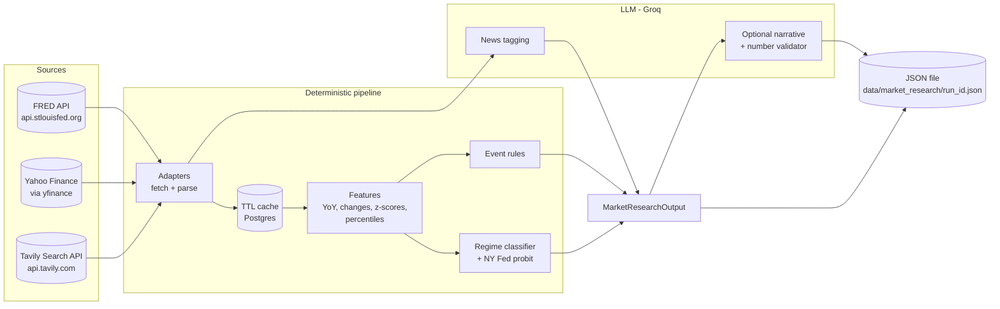

# Market Researcher Agent

The market researcher collects **current US macro, rates, credit and market data plus recent macro news** from public data APIs. It turns that data into a **structured, cited JSON report**:

- notable events;
- the **economic cycle phase**;
- a **12-month recession probability**;
- every underlying number, with its date and source.

It is built for a **main agent (orchestrator)**, which calls it over HTTP and synthesizes the JSON later. The chat UI can also reach it through triage.

> **Core rule: numbers come from code, not from the LLM.**
> All fetching, maths, event detection and the cycle classification are deterministic Python. The LLM does only two things: it tags news headlines, and it optionally writes a narrative. Every number in that narrative is checked against the data before it is accepted.

---

## Contents

1. [At a glance](#1-at-a-glance)
2. [Data sources: which websites and APIs, and why](#2-data-sources-which-websites-and-apis-and-why)
3. [How each source is fetched and parsed](#3-how-each-source-is-fetched-and-parsed)
4. [Turning raw data into indicators (feature extraction)](#4-turning-raw-data-into-indicators-feature-extraction)
5. [Notable-event detection](#5-notable-event-detection)
6. [Economic cycle classifier and recession probability](#6-economic-cycle-classifier-and-recession-probability)
7. [News processing: ranking, de-duplication, tagging](#7-news-processing-ranking-de-duplication-tagging)
8. [Optional narrative and the number validator](#8-optional-narrative-and-the-number-validator)
9. [Output: the JSON report](#9-output-the-json-report)
10. [How to call it: HTTP API, CLI, chat](#10-how-to-call-it-http-api-cli-chat)
11. [Reliability: caching, retries, rate limits, timeouts, degradation](#11-reliability-caching-retries-rate-limits-timeouts-degradation)
12. [Storage](#12-storage)
13. [Configuration](#13-configuration)
14. [Backtest](#14-backtest)
15. [Testing](#15-testing)
16. [Code map](#16-code-map)
17. [Limitations and extending it](#17-limitations-and-extending-it)

---

## 1. At a glance



| | |
|---|---|
| **Data per run** | 35 FRED series, 25 market symbols, about 50 news results reduced to the top 15 |
| **Typical latency** | about 30s cold (mostly the FRED fan-out); about 5–10s warm (cache) |
| **LLM calls per run** | 1 (news tagging), plus 1–2 when a narrative is requested |
| **Output** | One JSON file per run, also served over HTTP |
| **Region** | US only (v1). Other regions return HTTP 422 |
| **Model** | Groq `openai/gpt-oss-120b` via the repo's shared `get_groq_model()` |

**Execution flow for one run** (`service.py → MarketResearchService.run`):

1. Validate the request (`region` must be `US`).
2. Fetch from FRED, Yahoo Finance and Tavily **in parallel**, each under its own timeout. A failing source is recorded and the run continues.
3. Compute features for each FRED series, building indicators and a market snapshot.
4. Run the event rules, then the regime classifier (reading and updating the stored last regime).
5. Tag the news with one batched LLM call, falling back to keyword tagging.
6. *(Optional)* Generate the narrative, which has to pass the number validator.
7. Write `MarketResearchOutput` atomically to `<output_dir>/<run_id>.json`.

---

## 2. Data sources: which websites and APIs, and why

The research pipeline **does not scrape HTML**. Every source is a structured API that returns JSON or tabular data. Scrapers are brittle, slow, often against site terms, and hard to test. Runs use only the snippet the news API returns.

The one exception is the chat UI's **article reader** (§3.4). When a user clicks a cited source link, that single article page is fetched and its main text is extracted for a side panel. This is the narrow fallback the design guide allows (`market_researcher_agent.md` §3.4): only URLs a run already cited, robots.txt respected, short timeouts, and graceful failure.

| Source | What it provides | Endpoint / library | Auth | Cost | Rate limit we enforce |
|---|---|---|---|---|---|
| **FRED** (Federal Reserve Bank of St. Louis), [fred.stlouisfed.org](https://fred.stlouisfed.org) | All macro, rates, credit, financial-conditions and sentiment series | `GET https://api.stlouisfed.org/fred/series/observations` | `FRED_API_KEY` (free; [get one here](https://fred.stlouisfed.org/docs/api/api_key.html)) | Free | 2 req/s, burst 10 (FRED documents 120 req/min) |
| **ALFRED** (FRED's archive of past data versions) | The value of a series **as it was known on a past date** | Same endpoint, with `realtime_start`/`realtime_end` | Same key | Free | Same bucket |
| **Yahoo Finance**, [finance.yahoo.com](https://finance.yahoo.com) | Daily closing prices for ETFs, indices and futures | [`yfinance`](https://github.com/ranaroussi/yfinance) Python library (an **unofficial** wrapper around Yahoo's JSON endpoints) | None | Free | One batched download per run |
| **Tavily**, [tavily.com](https://tavily.com) | Recent news search results (title, URL, snippet, publish date) | `POST https://api.tavily.com/search` with `topic: "news"` | `TAVILY_API_KEY` (shared with the chat agents) | Free tier / paid | 4 req/s, burst 4 |
| **Groq**, [groq.com](https://groq.com) | LLM for news tagging and the optional narrative | `langchain_groq.ChatGroq` via `app.core.get_groq_model()` | `GROQ_API_KEY` | Paid / free tier | n/a (1–3 calls per run) |

Every number in the output links back to a page a human can check: FRED series pages (`https://fred.stlouisfed.org/series/<ID>`), Yahoo quote pages (`https://finance.yahoo.com/quote/<SYMBOL>`) and the original news article URLs.

### 2.1 FRED series pulled (35 live, plus 1 backtest-only)

Defined in `config.py → US_SERIES`. **Shown as** is what appears in `Indicator.value` (see §4.2).

| Category | Series ID | Name | Frequency | Shown as |
|---|---|---|---|---|
| Yields | `DGS3MO`, `DGS2`, `DGS10`, `DGS30` | Treasury constant-maturity yields (3M, 2Y, 10Y, 30Y) | Daily | Level, % |
| Curve | `T10Y2Y`, `T10Y3M` | 10Y−2Y and 10Y−3M spreads | Daily | Level, pp |
| Policy rate | `DFF` | Effective fed funds rate | Daily | Level, % |
| | `DFEDTARU`, `DFEDTARL` | Fed target range upper / lower bound | Daily | Level, % |
| Real yields / breakevens | `DFII10` | 10Y TIPS real yield | Daily | Level, % |
| | `T5YIE`, `T10YIE` | 5Y / 10Y breakeven inflation | Daily | Level, % |
| Inflation | `CPIAUCSL`, `CPILFESL` | CPI, core CPI | Monthly | **YoY %** |
| | `PCEPI`, `PCEPILFE` | PCE price index, core PCE | Monthly | **YoY %** |
| Labor | `UNRATE` | Unemployment rate | Monthly | Level, % |
| | `PAYEMS` | Nonfarm payrolls | Monthly | **3-month average monthly change**, thousands |
| | `ICSA`, `CCSA` | Initial / continuing jobless claims | Weekly | Level, claims |
| | `SAHMREALTIME` | Sahm rule recession indicator (real-time) | Monthly | Level, pp |
| Growth | `GDPC1` | Real GDP | Quarterly | **YoY %** |
| | `INDPRO` | Industrial production | Monthly | **YoY %** |
| | `RSAFS` | Retail sales (nominal) | Monthly | **YoY %** |
| | `PI`, `DSPIC96` | Personal income; real disposable income | Monthly | **YoY %** |
| Housing | `HOUST`, `PERMIT` | Housing starts; building permits | Monthly | Level, thousands (SAAR) |
| Credit | `BAMLH0A0HYM2` | ICE BofA US High Yield OAS (**only ~3 years on FRED**) | Daily | Level, % |
| | `BAMLC0A0CM` | ICE BofA US Investment Grade OAS (**only ~3 years on FRED**) | Daily | Level, % |
| | `BAA10Y` | Moody's Baa corporate yield minus 10Y Treasury (from 1986). **The credit input to the regime model** | Daily | Level, pp |
| Financial conditions | `NFCI` | Chicago Fed National Financial Conditions Index | Weekly | Level (0 = average; >0 tighter) |
| | `STLFSI4` | St. Louis Fed Financial Stress Index | Weekly | Level |
| Volatility / sentiment | `VIXCLS` | CBOE VIX (FRED copy) | Daily | Level |
| | `UMCSENT` | UMich consumer sentiment | Monthly | Level |
| *Backtest only* | `USREC` | NBER recession indicator (0/1) | Monthly | *never reported live* |

How far back each request goes depends on frequency (`HISTORY_YEARS`): daily 25 years, weekly 35, monthly and quarterly 50. That covers 10-year z-scores and percentiles plus long "highest since" lookbacks.

**Not available on FRED, so omitted:** ISM Manufacturing PMI (licensed data).

### 2.2 Market symbols pulled from Yahoo Finance (25)

Defined in `config.py → WATCHLIST`.

| Group | Symbols |
|---|---|
| Equity indices (ETFs) | `SPY` (S&P 500), `QQQ` (Nasdaq-100), `IWM` (Russell 2000), `EFA` (developed ex-US), `EEM` (emerging markets) |
| US sectors (SPDR ETFs) | `XLK`, `XLF`, `XLE`, `XLV`, `XLY`, `XLP`, `XLI`, `XLU`, `XLB`, `XLRE`, `XLC` |
| Rates / credit proxies | `TLT` (20+Y Treasuries), `IEF` (7–10Y Treasuries), `HYG` (high yield), `LQD` (investment grade) |
| Macro assets | `DX-Y.NYB` (US Dollar Index), `CL=F` (WTI crude futures), `GLD` (gold), `HG=F` (copper futures) |
| Volatility | `^VIX` |

The agent fetches 400 calendar days of daily closes, enough for 52-week highs and 1-year changes.

### 2.3 News queries sent to Tavily

`config.py → NEWS_QUERIES` (8 fixed queries), plus one query per **focus term** in the request (`"<term> market news"`) and the request's own `query` text:

```
"Treasury yields" OR "bond yields"
"Federal Reserve" rate decision OR FOMC
inflation CPI report
jobs report payrolls
recession fears economy
oil prices OPEC
"credit spreads" corporate bonds
stock market today
```

Each query asks for up to 6 results (`NEWS_RESULTS_PER_QUERY`). After filtering and de-duplication, the top 15 (`NEWS_TOP_N`) are kept (§7).

---

## 3. How each source is fetched and parsed

All adapters live in `adapters/` and return **plain normalized objects**, so the analytics code never sees a provider's response format:

```python
@dataclass(frozen=True)
class SeriesPoint:      # adapters/base.py
    date: date
    value: float
```

### 3.1 FRED (`adapters/fred.py`)

**Request.** One HTTP GET per series:

```
GET https://api.stlouisfed.org/fred/series/observations
    ?series_id=DGS10
    &api_key=<FRED_API_KEY>
    &file_type=json
    &observation_start=2001-10-16          # as_of minus HISTORY_YEARS
    [&observation_end=2026-06-30]          # only when replaying a past as_of
    [&realtime_start=2026-06-30&realtime_end=2026-06-30]   # ALFRED vintage (see below)
```

**Response** (abridged; a real recorded example is in `tests/fixtures/market_researcher/fred_dgs10.json`):

```json
{
  "observation_start": "2026-09-01",
  "count": 11,
  "observations": [
    {"realtime_start": "2026-10-15", "realtime_end": "2026-10-15", "date": "2026-09-01", "value": "4.79"},
    {"realtime_start": "2026-10-15", "realtime_end": "2026-10-15", "date": "2026-09-07", "value": "."},
    ...
  ]
}
```

**Parsing** (`parse_observations`):

- Read `observations[].date` and `observations[].value`.
- **`"."` means "no observation"** (holidays, not-yet-published values). These rows are **dropped**, never treated as 0.
- Values are strings, so they're converted to `float`. Malformed rows are skipped.
- The result is sorted ascending by date and returned as `list[SeriesPoint]`.

**Parallelism.** The service fires all 35 series concurrently (`asyncio.gather`). A shared token bucket keeps it to 2 requests/second, which is why a cold run takes about 15–20s for FRED alone. A failure on one series is recorded as `FRED:<ID>` in `data_quality.failed_sources`. The other series still run, and the whole source counts as failed only if **every** series fails.

**Revisions and vintages (ALFRED).** Macro data is revised after release; payrolls and GDP, for example, change a month or two later. When a request sets **`as_of` to a past date**, monthly and quarterly series are fetched with `realtime_start = realtime_end = as_of`. FRED then returns each observation **as it was published on that date**, which avoids look-ahead bias. If ALFRED has no vintage for that date, the agent falls back to the revised data and adds a note to `data_quality.notes`. Live runs (`as_of = today`) use the latest data.

**Security note.** FRED accepts the API key only as a URL query parameter, and the `httpx` library logs full request URLs at INFO level. `adapters/base.py` sets the `httpx` logger to WARNING so the key never appears in logs.

### 3.2 Yahoo Finance via yfinance (`adapters/market_data.py`)

**Request.** One **batched** call for every symbol not already cached:

```python
yf.download(
    ["SPY", "QQQ", ..., "^VIX"],
    start="2025-09-11",            # as_of - 400 days
    end="2026-10-17",              # as_of + 1 day (yfinance's end date is exclusive)
    auto_adjust=True,              # prices adjusted for splits and dividends
    progress=False,
    threads=True,
    group_by="column",
)
```

**Response.** A pandas DataFrame with **two-level columns**, `(field, ticker)`, e.g. `("Close", "SPY")`.

**Parsing** (`_download_closes`):

- Take only the `"Close"` block. With a single symbol yfinance returns a Series instead, which is converted to a one-column frame.
- For each ticker column, keep `(timestamp.date(), float(close))` for every row where the close is **not NaN**. Holidays and missing data become NaN in the aligned frame.
- Tickers with no valid rows are **omitted** from the result rather than raising an error, so one delisted or broken symbol doesn't sink the snapshot.

yfinance is synchronous, so the call runs in a worker thread (`asyncio.to_thread`). Any exception it raises is wrapped as `SourceError("yfinance: ...")`, and the run continues without prices.

> yfinance is unofficial and can break when Yahoo changes its endpoints. It sits behind the `MarketDataProvider` protocol, so a paid provider (Polygon, Twelve Data, Finnhub…) can replace it by implementing one method: `get_histories(symbols, start, end)`.

### 3.3 Tavily news search (`adapters/news.py`)

**Request.** One HTTP POST per query:

```json
POST https://api.tavily.com/search
{
  "api_key": "<TAVILY_API_KEY>",
  "query": "\"Treasury yields\" OR \"bond yields\"",
  "topic": "news",
  "days": 3,                    // request.lookback_days_news
  "max_results": 6,
  "search_depth": "basic",
  "include_answer": false,
  "include_raw_content": false
}
```

**Response** (abridged; a recorded example is in `tests/fixtures/market_researcher/tavily_news.json`):

```json
{
  "results": [
    {
      "url": "https://www.cnbc.com/2026/10/15/us-treasury-yields-investors-economic-data-.html",
      "title": "U.S. Treasury yields: investors await more economic data",
      "content": "U.S. Treasury yields declined on Thursday as investors awaited ...",
      "score": 0.83,
      "published_date": "Thu, 15 Oct 2026 07:52:47 GMT"
    }
  ]
}
```

**Parsing** (`parse_tavily`):

| Output field | Taken from | Processing |
|---|---|---|
| `title` | `title` | Trimmed. Results with no title or URL are dropped |
| `url` | `url` | As returned |
| `source` | `url` | The domain, with `www.` stripped (e.g. `cnbc.com`) |
| `published_at` | `published_date` | Parsed as RFC 2822 (`Thu, 15 Oct 2026 07:52:47 GMT`), falling back to ISO 8601. Unparseable becomes `None`. Always timezone-aware (UTC if none given) |
| snippet | `content` | Trimmed, capped at 500 characters. Used for ranking and tagging, **never published in the output** |
| provider score | `score` | Tavily's own relevance score, 0–1 |

The research pipeline **never opens the article pages**. Everything a run knows about an article comes from the title and the snippet Tavily returns. The output's `summary` field is a one-sentence rewrite in the agent's own words (§7.2), not a quote. Article pages are fetched only on demand by the chat's reader view (§3.4), and that text never feeds back into a run.

---

### 3.4 Article reader view (`article_reader.py`, chat side panel only)

In the chat, clicking a source link in a Market Researcher reply opens a **side panel** instead of leaving the page. An iframe of the live page is not an option, because most news sites forbid embedding. In a real run, 8 of 15 sources sent `X-Frame-Options` or a CSP `frame-ancestors` header, and several others block bots or are paywalled. So the panel shows **extracted article text**, like a browser's reader mode.

**Request:** `GET /agents/market-researcher/articles?run_id=<run_id>&url=<article url>`

**How one article is read:**

1. **Allowlist check.** `run_id` must match `mr_YYYYMMDDTHHMMSSZ_xxxxxx`, its JSON file must exist, and `url` must be **exactly one of that run's `news[].url` values**. Anything else returns HTTP 404. The endpoint therefore can't be used as an open proxy.
2. **Cache.** Results are cached by URL hash (`article:<sha256>`): extracted articles for 24h, failures for 1h.
3. **robots.txt.** The site's `/robots.txt` is fetched and checked with `urllib.robotparser` for the reader's user agent (`MarketResearcherReader/1.0`). If a site disallows it (e.g. WSJ), the result is "unavailable". Per RFC 9309, a missing robots.txt (4xx) means no restrictions.
4. **Fetch.** The page is fetched with `httpx`:
   - 10s timeout;
   - up to 5 redirects;
   - HTML only;
   - at most 3 MB.

   Every request, **including each redirect**, is checked to resolve to a **public** IP address, with no private, loopback or link-local targets. This guards against SSRF.
5. **Extract.** [trafilatura](https://trafilatura.readthedocs.io) runs with `favor_precision=True`, no comments and no tables. It returns the main body text plus title, author and date, and drops navigation, ads and related-link blocks. A leading paragraph that just repeats the title is dropped. Text under 400 characters counts as **no article**: typically a video page, consent wall or paywall teaser.
6. **Respond.** The response merges the run's own metadata for that item (the agent's summary, topics, sentiment, market impact) with the extracted `title`, `author`, `published` and `paragraphs`, plus `status: "ok"`, or `status: "unavailable"` with a human-readable `reason`.

**Live hit rate** (one real run): 10 of 15 sources returned full text. The other 5:
- **paywall or bot block:** Seeking Alpha, NYT;
- **robots.txt disallows:** WSJ;
- **video pages with no article body:** 2 CNBC links.

For these, the panel still shows the agent's summary and tags, and an **Open original ↗** button opens the real page in a new tab.

This endpoint is called by the browser, so it sits on a separate router **without** the `MARKET_RESEARCH_API_TOKEN` requirement. It can only read articles a run already cited.

**Frontend.**
- `ArticlePanel.tsx` renders the panel. It is docked on the right on desktop and full-screen on mobile, and closes with ✕ or Esc.
- `MessageList.tsx` intercepts clicks on links in any assistant message containing a run id.
- Cmd-, Ctrl-, Shift- and middle-clicks still open the original page.

---

## 4. Turning raw data into indicators (feature extraction)

All maths is in `features.py`. It uses the Python standard library only (`statistics`, `bisect`, `math`); there is no numpy or pandas.

### 4.1 Date handling

- **Truncation to `as_of`:** every computation uses only points dated on or before `as_of`, so replays never see future data.
- **Calendar windows, not row counts:** "1 month ago" means the observation nearest to `latest_date − 30 days`, so daily, weekly and monthly series behave the same. The nearest point must be **strictly before** the latest observation and within a tolerance of `max(5 days, 25% of the window)`. Otherwise the change is reported as **missing**, not guessed. For example, the 1-day change on a Monday compares against Friday.
- **Year-ago matching** for YoY uses calendar-month shifting (with day clamping, so 29 Feb maps to 28 Feb). The tolerance is 3 days for monthly series and 4–5 days for the others.

### 4.2 Transforms (what `Indicator.value` shows)

Each series has a `transform` in `config.py`:

| Transform | Used for | Formula |
|---|---|---|
| `level` | Yields, spreads, rates, unemployment, claims, OAS, NFCI, VIX, housing, sentiment | The raw value |
| `yoy` | Price indexes (CPI, PCE), GDP, IP, retail sales, income | `(v_t / v_{t−1y} − 1) × 100` |
| `diff_3m_avg` | Payrolls | `(v_t − v_{t−3}) / 3`, the average monthly change over 3 months |

For monthly `yoy` series the agent also computes the **3-month annualized rate**, `((v_t / v_{t−3})^4 − 1) × 100`. Event rules and the classifier use it to detect re-acceleration.

### 4.3 Per-indicator statistics

For each FRED series, `compute_indicator_features()` produces:

| Field | Meaning | Computation |
|---|---|---|
| `value`, `observation_date` | Latest transformed value and its date | Last point of the transformed series |
| `changes` | Moves over standard windows, **in the value's own unit** (pp for % series) | Daily: `1d 1w 1m 3m 1y`; weekly: `1w 1m 3m 1y`; monthly: `1m 3m 1y`; quarterly: `1q 1y` |
| `percentile_10y` | Where the latest value sits within the last 10 years (0–100) | **Mid-rank**: `(count below + ½ × count equal) / n`, so a flat series sits at the 50th percentile, not the 100th |
| `stats_window_years` | How many years of history are **actually** behind `percentile_10y` and `zscore_10y` | `min(10, years of history available)`. When it is under 10, `data_quality.notes` says so. FRED serves the ICE BofA OAS series for only about 3 years, so their "10-year" percentile is really a 3-year one: in October 2026 HY OAS read as the 77th percentile of 3 years, while the long-history Baa spread was at the **2nd percentile of 10 years** |
| `zscore_10y` | Distance from the 10-year mean in standard deviations | `(latest − mean) / population stdev` (needs ≥ 8 points) |
| `stale` | Data is older than expected | `as_of − observation_date > period + grace`. Grace: daily 5 days, weekly 12, monthly 60, quarterly 120 (monthly data routinely lands 2–6 weeks after the month) |
| `signal` | Direction label for the recent move | See below |

**`signal` rules.** Each series config defines which move matters, how big it must be, and what label each direction gets:

| Example | Window | Threshold | Up | Down |
|---|---|---|---|---|
| `DGS10` | 1m | 0.15pp | `tightening` | `easing` |
| `CPILFESL` (YoY) | 3m | 0.15pp | `inflationary` | `disinflationary` |
| `UNRATE` | 3m | 0.10pp | `bearish_growth` | `bullish_growth` |
| `T10Y3M` | 3m | 0.20pp | `bullish_growth` (steepening) | `bearish_growth` |
| `BAMLH0A0HYM2` | 1m | 0.25pp | `tightening` | `easing` |

Moves inside the threshold are labelled `neutral`.

**Market snapshot.** Prices get a simpler treatment. `value` is the last close, and `changes` are **percentage returns** over `1d 1w 1m 3m 1y`. There is no percentile or signal.

---

## 5. Notable-event detection

`events.py` runs 12 rules. Each one reads the series and prices, and returns `Event(id, severity, description, evidence)`. Descriptions are plain sentences **containing the actual numbers and lookbacks**. They never say "all-time high" unless the value really is the maximum of the fetched history, and in that case they state where the history starts. All thresholds live in `config.py → EventThresholds`.

| Rule | Fires when | Severity | Example description |
|---|---|---|---|
| Yield multi-year high | `DGS10`/`DGS30` is the highest it has been in ≥ 2 years | `notable`; `major` if ≥ 10 years or the history maximum | "10-year Treasury yield at 5.21% on 2026-10-13 is the highest since 2007-06-12 (19.3 years)." |
| Sharp yield move | 10Y moves > 25bp in 1 week or > 50bp in 1 month | `notable` | "10-year Treasury yield moved sharply up: +31bp over 1 week (now 5.19%)." |
| Curve inversion / un-inversion | `T10Y3M` or `T10Y2Y` changes sign within 30 days; or remains inverted | `notable`; un-inversion after ≥ 180 days inverted (in the last 2y) is `major`; still inverted is `info` | "10Y-3M curve turned positive (0.10pp) after about 400 days inverted…" |
| Sahm rule | `SAHMREALTIME` ≥ 0.50 (triggered) or ≥ 0.30 (warning) | `major` / `notable` | "Sahm rule triggered: real-time indicator at 0.53pp…" |
| Claims rising | 4-week average of `ICSA` > 15% above its 52-week low | `notable` | "Initial jobless claims 4-week average at 260,000 is 30% above its 52-week low…" |
| Credit stress | **Widening:** HY OAS > 100bp wider in 3 months, or, without HY data, the Baa−Treasury spread > 50bp wider. **Level:** the Baa−Treasury spread (`BAA10Y`) above the 80th percentile of its last 10 years. The level test deliberately avoids HY OAS, which has only ~3 years of history | `notable`; `major` if both | "Credit stress: high-yield OAS widened 150bp in 3 months to 4.50%; the Baa-Treasury spread at 2.90pp is at the 92nd percentile of the last 10.0 years." |
| Financial conditions | `NFCI` > 0, or up > 0.20 in 3 months | `notable` | "Chicago Fed NFCI at 0.10 (above 0 = tighter than average)." |
| Inflation re-acceleration | Core CPI 3m annualized exceeds core CPI YoY by > 0.5pp | `notable` | "Core CPI re-accelerating: 3-month annualized 3.41% vs 2.57% YoY (2026-09-01)." |
| Equity drawdown | SPY > 10% (correction) or > 20% (bear market) below its 52-week high | `notable` / `major` | "S&P 500 (SPY) is 12.3% below its 52-week high (correction)." |
| Volatility spike | VIX > 30, or up > 50% in a week (`^VIX` from Yahoo; falls back to FRED `VIXCLS`) | `notable` | "VIX at 32.40, up 61% in a week." |
| Oil shock | WTI (`CL=F`) up > 25% over 3 months | `notable` | "WTI crude up 31% over 3 months to $95.74/bbl." |
| Fed policy change | `DFEDTARU` changed in the last 60 days | `notable` | "Fed raised its target range by 25bp in the last 60 days (now 3.75-4.00%)." |

Events are sorted `major → notable → info`.

---

## 6. Economic cycle classifier and recession probability

`regime.py` uses a **transparent, score-based** model, so every call can be explained and backtested. The live service and the backtest share exactly the same code path.

### 6.1 Recession probability: NY Fed yield-curve model

```
P(recession within 12 months) = Φ(α + β × spread)
α = −0.5333,  β = −0.6330,  spread = average of T10Y3M over the last 30 days
```

`Φ` is the standard normal CDF (`statistics.NormalDist().cdf`). These are the NY Fed's published "Yield Curve as a Leading Indicator" coefficients. A 0pp spread gives about 30%, and −1pp gives about 54%. The result goes in `regime.recession_prob_12m` (0–1). It is a **model estimate** that depends only on the yield curve, separate from the phase call below.

### 6.2 Step 1: four composite scores

| Composite | Components (weights) | How each component is scored |
|---|---|---|
| **G**, growth level | Industrial production YoY (1.0); real retail sales YoY = retail YoY − CPI YoY (0.75); payrolls 3m avg change (1.0); real GDP YoY (0.75); unemployment minus its 12-month low, **inverted** (1.25); jobless claims 4-wk avg YoY, **inverted** (1.0) | 10-year z-score of each component; weighted average of those available (needs ≥ 2) |
| **M**, growth momentum | Same components | Change over the last **6 months** in units of the component's 10-year standard deviation; weighted average |
| **I**, inflation pressure | Core CPI YoY (anchor 2.0, scale 1.0); core PCE YoY (2.0, 1.0); core CPI 3m annualized (2.0, 1.5); 5Y breakeven (2.25, 0.35) | `(value − anchor) / scale`, averaged. Positive means above target |
| **P**, policy / financial stance | Real policy rate = DFF − core PCE YoY − 0.5 neutral (1.0); curve flatness = −T10Y3M (0.75); **Baa−Treasury spread** (`BAA10Y`) 10y z-score (1.0); NFCI (1.0) | Weighted average. Positive means restrictive or tight |

"Inverted" means a higher value is *worse* for growth, so the sign is flipped. All composites are reported in `regime.composites`.

### 6.3 Step 2: base quadrant scores

Each phase gets `score = sG × G + sM × M`, with these signs:

| | Momentum rising (sM = +) | Momentum falling (sM = −) |
|---|---|---|
| **Growth above trend (sG = +)** | `early_expansion` | `late_expansion` |
| **Growth below trend (sG = −)** | `late_recession` (trough forming) | `recession` |

The highest base score is exactly the classic growth/momentum quadrant.

### 6.4 Step 3: confirmation adjustments

Conditions that confirm a phase **add to that phase's score**: +0.35 each, or +0.75 for "strong" ones. They shift scores and never override the call.

| Toward | Conditions |
|---|---|
| `late_expansion` | Unemployment within 0.25pp of its 12m low and below its 40th percentile; I > 0.5; P > 0.5; `T10Y3M` < 0.25 (flat or inverted); Baa−Treasury spread below 35th percentile but widening; fed funds up > 25bp in 6m |
| `early_expansion` | Unemployment above 60th percentile but falling; `T10Y3M` > 1.0 (steep); fed funds down > 25bp in 6m, or real policy rate < 0; I < 0; Baa−Treasury spread above 50th percentile and tightening |
| `recession` | **Sahm rule ≥ 0.5 (strong)**; claims 4-wk avg > 20% above a year ago; Baa−Treasury spread > 50bp wider in 3m; **payrolls 3m avg < 0 (strong)**; probit > 0.5 |
| `late_recession` | Fed funds down > 1pp in 6m; Baa−Treasury spread above 70th percentile but tightening over 1m; claims elevated but below their level 8 weeks ago; SPY > 15% above its 6-month low; permits up > 5% and sentiment up > 3 points in 3m while G < 0 |

### 6.5 Step 4: probabilities and confidence

- **Probabilities:** softmax of the four scores with temperature 0.6, giving `regime.probabilities`, which sum to 1.
- **Confidence** comes from the margin between the top two probabilities:

  | Margin | Confidence |
  |---|---|
  | ≥ 0.35 | `high` |
  | ≥ 0.15 | `medium` |
  | Otherwise | `low` |

  It is also forced to `low` if momentum couldn't be computed.

### 6.6 Step 5: hysteresis

The last call is stored per region (`market_regime_state` table). The phase switches only if the new phase's probability beats the previous phase's probability by **at least 0.10**. Otherwise the previous phase is kept and a note is added to `conflicting_signals`. This stops the call flip-flopping on noise. `previous_phase` and `changed` record what happened. Replays with a past `as_of` don't read or write this state.

### 6.7 Explanations in the output

- **`drivers`:** the top 5 positive contributions to the chosen phase. These are growth components (`growth_above_trend`/`growth_below_trend`), momentum components (`growth_improving`/`growth_deteriorating`) and fired adjustments (`favors_<phase>`).
- **`conflicting_signals`:** adjustments that favor *another* phase, components arguing against the call by more than 0.25, and hysteresis notes. These are always reported, never hidden.

If fewer than two growth components are available, `phase` is `null`, `confidence` is `low`, and the reason is given. The agent never fakes a call.

---

## 7. News processing: ranking, de-duplication, tagging

### 7.1 Filtering and ranking (`collect_news`)

1. **Fan-out:** run all queries concurrently: the 8 fixed queries plus the request's focus terms and question. Individual query failures are counted; the source fails only if **all** queries fail.
2. **Recency filter:** drop items published before `now − lookback_days_news`, because Tavily's own `days` filter is loose. Items with no date are kept.
3. **Score** each item:
   ```
   relevance = 0.5 × keyword_score + 0.3 × recency + 0.2 × tavily_score  (+0.4 if it came from the caller's own query/focus)
   keyword_score = |words in title+snippet ∩ words in all queries/focus| / min(#keywords, 8)
   recency       = 1 − age_hours / (lookback_days × 24)        (0.25 if undated)
   ```
   The +0.4 boost exists because without it, the generic macro queries crowded out results for a request's own topic (e.g. "China economy").
4. **De-duplicate**, highest relevance first:
   - **by URL:** scheme and host lowercased, `www.` removed, trailing `/` removed, query string and fragment dropped;
   - **by title:** any title at least 85% similar (`difflib.SequenceMatcher`) to one already kept is dropped. This catches the same wire story syndicated across outlets.
5. **Keep the top 15.**

### 7.2 Tagging (`news_tagging.py`)

All kept items go to the LLM in **one batched call** (title, domain and the first 300 characters of the snippet, numbered `[0]…[14]`). Structured output returns, for each item:

| Field | Values |
|---|---|
| `summary` | One sentence, at most 30 words, in the model's own words |
| `topics` | 1–3 lowercase tags (`rates`, `inflation`, `labor`, `fed`, `energy`, `credit`, `equities`, `fx`, `china`, `geopolitics`, `growth`, `housing`, `earnings`) |
| `sentiment` | `risk_on` / `risk_off` / `neutral`, i.e. the item's implication for risk assets |
| `market_impact` | `high` (central bank decisions, big data surprises, market-wide shocks) / `medium` / `low` |

The shared Groq client is copied with `max_tokens=4096` for this call. `gpt-oss` is a reasoning model whose reasoning tokens count against the limit, and the app default of 1024 is too small.

**Fallbacks:**
- **If the LLM call fails:** keyword tagging. Topics come from keyword lists, sentiment from counting risk-off words (*fall, slump, selloff, recession…*) against risk-on words (*rally, gains, record high…*), and the summary is the title. A note is added to `data_quality`.
- **If an item is missing from the LLM output:** that item is keyword-tagged.
- **If tagging would exceed the run budget:** keyword tagging.

---

## 8. Optional narrative and the number validator

Off by default, because the main agent normally writes the synthesis. Turn it on with `"include_narrative": true`. Chat runs always turn it on.

**Payload.** The LLM receives a compact JSON payload, **never raw series**:
- the regime;
- events;
- every indicator (value, date, changes, percentile, signal, stale flag);
- market prices, with keys spelled out as `trailing_1y_pct`, etc.;
- tagged news;
- `data_quality`.

**Prompt rules** (`prompts.yaml → market_researcher.synthesis_system`):
- use only numbers present in the data, with the same rounding or fewer decimals;
- label numbers exactly as the data defines them: trailing windows are never "YTD", and 10-year percentiles are never "record";
- cite indicator ids or URLs;
- give observation dates for lagged data;
- state the regime and its confidence, and name the main conflicting signal;
- describe implications, never recommendations;
- report data gaps.

**Output.** `key_themes` (3–6), `risks` (2–5), `implications` (by area, descriptive), `narrative` (150–300 words).

**Number validator** (`synthesis.py`):

1. Extract every number from the narrative, themes, risks and implications. The validator **ignores**:
   - dates (`2026-09-01`) and years (1900–2100);
   - indicator ids (`DGS10`, `T10Y3M`, `CL=F`);
   - tenors and periods (`10Y`, `3-month`, `52 weeks`);
   - ordinals (`80th`);
   - URLs and index names (`S&P 500`).
2. Build the **allowed set** from every number in the payload. Each value is also included **× 100**, so a probability of 0.1281 can appear as "12.8%" and a 0.22pp change as "22bp". Numbers that appear inside payload strings (event descriptions, titles) count too.
3. A number in the text passes if it matches an allowed number **within the rounding the text used**: "5.2" matches 5.19 (±0.05), "13%" matches 12.81 (±0.5).
4. A separate label check rejects **"YTD/year-to-date"** and **"record/all-time/near-record"** unless the payload itself uses those words.

**On failure,** the model gets **one retry**. It sees its rejected draft and the list of problems. If the retry also fails, or the LLM errors, a **deterministic template narrative** built from the regime, probabilities, probit, events and conflicts is used instead. `data_quality.notes` records why.

---

## 9. Output: the JSON report

Each run writes **one file**: `backend/data/market_research/<run_id>.json` (folder configurable). `run_id` looks like `mr_20261016T072553Z_4faf42` (UTC timestamp plus a random suffix). The write is atomic: a temp file is renamed into place.

**The contract:**
- Pydantic models in `schemas.py`;
- the JSON Schema committed as `market_research_output.schema.json`, regenerated with `python -m app.agents.market_researcher.schemas`;
- the same schema served at `GET /agents/market-researcher/schema`.

### Top-level fields

| Field | Type | Meaning |
|---|---|---|
| `schema_version` | `"1.1"` | Contract version (1.1 added `Indicator.stats_window_years`) |
| `agent` | `"market_researcher"` | Constant |
| `run_id`, `generated_at`, `as_of`, `region` | | Identity and timing |
| `request` | object | Echo of the request |
| `regime` | object | §6: `phase`, `probabilities`, `confidence`, `recession_prob_12m`, `composites` (G/M/I/P), `drivers`, `conflicting_signals`, `previous_phase`, `changed` |
| `events` | list | §5: `id`, `severity`, `description`, `evidence` |
| `indicators` | list | §4, one per FRED series: `id`, `name`, `category`, `value`, `unit`, `observation_date`, `changes`, `percentile_10y`, `zscore_10y`, `stats_window_years`, `signal`, `stale`, `source`, `source_url` |
| `market_snapshot` | list | Same shape, one per symbol; `changes` are **% returns** |
| `news` | list | §7: `title`, `source`, `url`, `published_at`, `summary`, `topics`, `sentiment`, `market_impact` |
| `key_themes`, `risks`, `implications`, `narrative` | | §8, `null` unless `include_narrative` |
| `data_quality` | object | `failed_sources`, `stale_series`, `notes`. **Check this first**: if all three are empty the run is complete |

### Example (abridged real output)

```json
{
  "schema_version": "1.1",
  "agent": "market_researcher",
  "run_id": "mr_20261016T072553Z_4faf42",
  "generated_at": "2026-10-16T07:25:53Z",
  "as_of": "2026-10-16",
  "region": "US",
  "request": {"query": null, "region": "US", "focus": ["rates"], "lookback_days_news": 3, "as_of": null, "include_narrative": false},
  "regime": {
    "phase": "late_expansion",
    "probabilities": {"early_expansion": 0.2958, "late_expansion": 0.3859, "recession": 0.1341, "late_recession": 0.1842},
    "confidence": "low",
    "recession_prob_12m": 0.1281,
    "composites": {"G": 0.142, "M": 0.095, "I": 0.686, "P": -0.088},
    "drivers": [
      {"indicator": "Inflation pressure elevated (I)", "value": 0.686, "direction": "favors_late_expansion", "contribution": 0.35},
      {"indicator": "Unemployment vs 12m low (UNRATE)", "value": 0.1, "direction": "growth_above_trend", "contribution": 0.067}
    ],
    "conflicting_signals": [],
    "previous_phase": "late_expansion",
    "changed": false
  },
  "events": [
    {"id": "core_inflation_reaccelerating", "severity": "notable",
     "description": "Core CPI re-accelerating: 3-month annualized 3.41% vs 2.57% YoY (2026-09-01).", "evidence": ["CPILFESL"]},
    {"id": "fed_raised", "severity": "notable",
     "description": "Fed raised its target range by 25bp in the last 60 days (now 3.75-4.00%).", "evidence": ["DFEDTARU", "DFEDTARL"]}
  ],
  "indicators": [
    {"id": "DGS10", "name": "10-Year Treasury Yield", "category": "rates", "value": 5.19, "unit": "%",
     "observation_date": "2026-10-14", "changes": {"1d": -0.02, "1w": -0.09, "1m": 0.22, "3m": 0.64, "1y": 1.16},
     "percentile_10y": 99.5, "zscore_10y": 1.85, "stats_window_years": 10.0, "signal": "tightening", "stale": false,
     "source": "FRED", "source_url": "https://fred.stlouisfed.org/series/DGS10"}
  ],
  "market_snapshot": [
    {"id": "SPY", "name": "S&P 500 ETF", "category": "equity_index", "value": 771.79, "unit": "USD",
     "observation_date": "2026-10-15", "changes": {"1d": 0.28, "1w": -0.28, "1m": 2.15, "3m": 3.06, "1y": 17.28},
     "percentile_10y": null, "zscore_10y": null, "signal": "neutral", "stale": false,
     "source": "Yahoo Finance (yfinance)", "source_url": "https://finance.yahoo.com/quote/SPY"}
  ],
  "news": [
    {"title": "Mortgage Rates Hold Steady at 3-Year High as Bond Market Stabilizes", "source": "…", "url": "https://…",
     "published_at": "2026-10-15T…Z", "summary": "…", "topics": ["rates", "housing", "bond"],
     "sentiment": "neutral", "market_impact": "medium"}
  ],
  "key_themes": null, "risks": null, "implications": null, "narrative": null,
  "data_quality": {"failed_sources": [], "stale_series": [], "notes": []}
}
```

---

## 10. How to call it: HTTP API, CLI, chat

### 10.1 HTTP API (primary interface, for the main agent)

The router is in `app/endpoints/market_researcher.py`, mounted under `/agents/market-researcher`.

| Method & path | Purpose | Responses |
|---|---|---|
| `POST /runs` | Start a run. Body is a `MarketResearchRequest` | **202** `{run_id, status, status_url, output_url, …}`. With `?wait=true`, **200** plus the full output once done (502 if it failed; 202 if it is still running after the budget plus 60s) |
| `GET /runs/{run_id}` | Run status: `queued`, `running`, `succeeded`, `partial` (some sources failed but output was produced) or `failed` | 200 / 404 |
| `GET /runs/{run_id}/output` | The run's JSON file | 200 / 404 unknown / 409 not finished or failed / 410 file gone |
| `GET /latest?region=US&max_age_minutes=60` | Most recent successful output within the age limit, so the caller can skip a run | 200 / 404 |
| `GET /schema` | JSON Schema of the output | 200 |
| `GET /health` | Which keys are configured, provider names, storage reachability, whether auth is required | 200 |
| `GET /articles?run_id=&url=` | Reader view of one article that run cited (§3.4). Used by the chat side panel; **no token required** | 200 (`status` ok or unavailable) / 404 (not a cited URL) |

**Request body** (`MarketResearchRequest`):

| Field | Default | Notes |
|---|---|---|
| `query` | `null` | The caller's question. Also used as a news query |
| `region` | `"US"` | `US` only for now; `EU`, `SG` and `GLOBAL` return 422 |
| `focus` | `[]` | Focus terms, e.g. `["rates", "energy"]`. Each adds a news query and a ranking boost |
| `lookback_days_news` | `3` | 1–14 |
| `as_of` | `null` (today) | Replay a past date: ALFRED vintages, no hysteresis state, news omitted beyond the lookback |
| `include_narrative` | `false` | Adds the validated narrative |

**Behavior:**
- **Concurrency:** at most `MARKET_RESEARCH_MAX_CONCURRENT_RUNS` (default 2) runs execute at once, with up to `MARKET_RESEARCH_MAX_QUEUED_RUNS` (default 8) more waiting. Beyond that the API returns **429** with `Retry-After: 30`.
- **Coalescing:** an identical request sent while one is already in flight returns the **same `run_id`**.
- **Missing key:** with no `FRED_API_KEY` configured, `POST /runs` returns **503**.
- **Auth:** if `MARKET_RESEARCH_API_TOKEN` is set, every route requires `Authorization: Bearer <token>` (constant-time comparison). Unset means open, for local dev.
- **Restarts:** runs left `queued`/`running` by a previous process are marked `failed` ("interrupted by restart") on startup.

```bash
# start (async) and poll
curl -X POST localhost:8000/agents/market-researcher/runs \
  -H 'content-type: application/json' -d '{"focus": ["rates", "energy"]}'
curl localhost:8000/agents/market-researcher/runs/<run_id>
curl localhost:8000/agents/market-researcher/runs/<run_id>/output

# or block until done
curl -X POST "localhost:8000/agents/market-researcher/runs?wait=true" \
  -H 'content-type: application/json' -d '{"query": "Are recession risks rising?", "include_narrative": true}'
```

Interactive docs: `http://localhost:8000/docs`.

### 10.2 CLI (dev and replays)

```bash
cd backend
python -m app.agents.market_researcher --focus rates,energy                 # live run
python -m app.agents.market_researcher --narrative --query "Are recession risks rising?"
python -m app.agents.market_researcher --as-of 2026-06-30 --out /tmp/mr      # replay a past date
python -m app.agents.market_researcher --use-db -v                           # Postgres cache + verbose timings
```

It prints a one-line summary and the path of the JSON file. By default it uses an in-memory cache.

### 10.3 Chat (optional)

Triage routes questions about **current macro or market conditions** to the **📈 Market Researcher** node (`app/agents/nodes/market_researcher.py`). The node:

1. Runs a structured scope check that also extracts up to 3 focus terms. Off-topic messages go back to triage.
2. Runs the pipeline with `include_narrative=True`.
3. Renders the result as Markdown (`render.py`): the phase with probabilities, the probit, the main conflict, the narrative, notable events, a table of 9 headline indicators, a table of 5 market prices, the top 5 news links, any data gaps, the run id and a disclaimer.
4. Passes the answer through the graph's `eval` node, including the compliance check.

Clicking a source link opens the **article side panel** (§3.4) instead of leaving the chat.

The full JSON for a chat answer is at `data/market_research/<run_id>.json` (the run id is in the reply's footer). Chat runs aren't in the HTTP run registry, so `/runs/<id>` won't find them.

The **Finance Expert is deliberately separate**: it has no tool access to this agent, and it hands macro-conditions questions back to triage.

---

## 11. Reliability: caching, retries, rate limits, timeouts, degradation

| Mechanism | Details |
|---|---|
| **Cache** (`cache.py`) | Keyed per item: `fred:<ID>:<latest\|as_of>:<vintage\|revised>`, `prices:<SYMBOL>:<latest\|as_of>`, `news:<provider>:<days>:<max>:<query>`, `article:<sha256 of url>` (reader view) |
| **Cache TTLs** | Daily series 1h; weekly 6h; monthly and quarterly 12h; prices 5 min; news 15 min; anything for a past `as_of` 7 days (it can't change) |
| **Retries** (`adapters/base.py`) | Up to 3 retries (4 attempts) with exponential backoff (0.5s, 1s, 2s) plus random jitter. **Only** on HTTP 429/500/502/503/504, timeouts and connection errors. Other 4xx errors (bad key, unknown series) fail immediately |
| **Rate limiting** | Async token buckets: FRED 2 req/s (burst 10), Tavily 4 req/s (burst 4) |
| **Timeouts** | Per HTTP request 10s; per source (FRED / prices / news) 45s; overall run budget 60s. News tagging gets whatever budget remains (at least 10s) |
| **Graceful degradation** | News fails: macro data, prices and the regime are still produced. Prices fail: macro, regime and news are produced. FRED fails: prices and news are produced, with `regime.phase = null` and `confidence = "low"`. Every failure is listed in `data_quality.failed_sources`, and the API status becomes `partial` |
| **Staleness** | Per-frequency grace periods (§4.3). Stale series are listed in `data_quality.stale_series` and flagged on the indicator |
| **Logging** | `market_researcher` logger: per-source attempt, status, latency and stage timings. No API keys, no request params |

---

## 12. Storage

| Where | What |
|---|---|
| `backend/data/market_research/<run_id>.json` | One output file per run (gitignored). In Docker, `./backend` is mounted, so files appear on the host. **Never deleted automatically** |
| Postgres `market_cache (key, value, expires_at)` | TTL cache. Expired rows are purged at startup |
| Postgres `market_regime_state (region, state, updated_at)` | Last regime per region, used for hysteresis |
| Postgres `market_research_runs (id, status, region, request, json_path, error, created_at, finished_at)` | HTTP run registry |

The tables are created by `cache.init_market_tables()` from the FastAPI lifespan in `app/app.py`. Without Postgres (CLI, tests), in-memory equivalents are used automatically.

---

## 13. Configuration

### Environment variables (repo-root `.env`)

| Variable | Required | Default | Purpose |
|---|---|---|---|
| `FRED_API_KEY` | **yes** | — | FRED / ALFRED access |
| `TAVILY_API_KEY` | for news | — | News search (shared with the chat agents) |
| `GROQ_API_KEY` | for tagging and narrative | — | LLM |
| `MARKET_RESEARCH_API_TOKEN` | no | unset (open) | Bearer token for the HTTP API |
| `MARKET_RESEARCH_OUTPUT_DIR` | no | `backend/data/market_research` | Where JSON files go |
| `MARKET_DATA_PROVIDER` | no | `yfinance` | Price provider |
| `NEWS_PROVIDER` | no | `tavily` | News provider |
| `MARKET_RESEARCH_MAX_CONCURRENT_RUNS` | no | `2` | Parallel runs |
| `MARKET_RESEARCH_MAX_QUEUED_RUNS` | no | `8` | Queue size before 429 |
| `MARKET_RESEARCH_SOURCE_TIMEOUT` | no | `45` | Seconds per source |
| `MARKET_RESEARCH_REQUEST_TIMEOUT` | no | `10` | Seconds per HTTP request |
| `MARKET_RESEARCH_RUN_BUDGET` | no | `60` | Seconds per run |
| `DATABASE_URL` | app only | local compose Postgres | Postgres connection |

### Tunables (`config.py`)

Everything analytical lives in `config.py`, never hard-coded in logic:
- the series map and transforms;
- the watchlist;
- news queries;
- history lengths;
- staleness grace periods;
- TTLs;
- every event threshold (`EventThresholds`);
- the probit coefficients;
- every regime weight, anchor and threshold, plus temperature, confidence bands and the hysteresis margin (`RegimeConfig`).

Prompts are versioned in `app/prompts/prompts.yaml` under `market_researcher:`:
- `scope_check_system` (chat node);
- `disclaimer`;
- `news_tagging_system`;
- `synthesis_system`;
- `synthesis_retry_note`.

You can pin a version without a code change: `PROMPT_VERSION_OVERRIDES='{"market_researcher.synthesis_system": "v1"}'`.

---

## 14. Backtest

```bash
cd backend
python -m app.agents.market_researcher.backtest                              # ~25s: model vs baselines -> backtest_report.md
python -m app.agents.market_researcher.backtest --walk-forward --ablation    # ~4 min on 10 cores: adds both sections
```

`backtest.py` runs the **same** `classify_regime` monthly from 1980 to the present, with hysteresis, and compares the calls with FRED's `USREC` (NBER recession dates).

**Inputs match the live model:**

| Input | Live | Backtest |
|---|---|---|
| Credit spread | `BAA10Y` | `BAA10Y` from 1986; monthly `BAA − GS10` before that |
| Yield curve | `T10Y3M` | `T10Y3M` from 1982; monthly `GS10 − TB3MS` before that |
| Equities (the "equities rallying off their lows" rule) | `SPY` | S&P 500 index `^GSPC` via yfinance. The rule is ratio-based, so the index and the ETF behave the same |
| Breakevens (`T5YIE`) | yes | Only from 2003; earlier inflation pressure uses CPI/PCE alone |

An earlier version used ICE BofA HY OAS for credit. FRED has only about 3 years of it, so before 2023 the backtest had no credit input at all, and the live model's credit logic was never tested. It also had no equity data.

**Avoiding look-ahead.** The backtest uses revised data, because fetching ALFRED vintages for every month would take about 10k API calls. Each series becomes visible only after a **publication lag**: daily 1 day, weekly 7, monthly 45, quarterly 90. Remaining revisions make the results somewhat optimistic.

**Metrics** (same scoring for the model and for every baseline):

| Metric | Meaning |
|---|---|
| Recessions caught | A `recession` call within ±3 months of the NBER dates |
| Mean first call vs start | Average lead (negative) or lag (positive), in months |
| Sustained false calls | Runs of ≥ 3 recession months more than 6 months from any NBER recession |
| False-call months | **Every** such month, including short blips the sustained count misses |
| Phase changes | How often the call switches: a noise or whipsaw measure |
| Brier skill | `1 − Brier / Brier(always forecast the base rate)` for P(recession) + P(late_recession) vs NBER months. Above 0 beats the base rate |

**Acceptance criteria:**
- at least 60% of NBER recessions caught;
- at most 3 sustained false calls.

### Results (1980-01 to 2026-08, 560 months)

| Model | Caught | Mean first call | Sustained false | False-call months | Phase changes | Brier skill |
|---|---|---|---|---|---|---|
| **Composite model** | 6/6 | −0.5 | 2 | 14 | 84 | −0.47 |
| Sahm rule (≥ 0.50) | 6/6 | +2.2 | 5 | 38 | 14 | n/a |
| Yield-curve probit > 50% | 2/6 | −2.0 | 2 | 20 | 11 | n/a |
| Sahm rule OR probit | 6/6 | +1.5 | 6 | 56 | 17 | n/a |

**PASS.** The composite catches all six recessions: 1980, 1981–82, 1990–91, 2001, 2008–09, 2020. The first calls came +2, +3, +1, −3, −3 and −3 months relative to each start. The 2 sustained false calls are the 2003 jobless recovery and the 2024 Sahm-rule trigger.

**Compared with the baselines,** the composite calls recessions **earlier** than the Sahm rule, with **far fewer false-call months** (14 vs 38). It is much **noisier**, though: 84 phase changes against 14.

**Brier skill is negative.** The phase "probabilities" are softmax scores, not calibrated probabilities; they score worse than always forecasting the base rate. Treat them as relative scores.

### Walk-forward (out-of-sample)

The tuning was done on 1980–2005 only: 72 configs over `momentum_months`, `hysteresis_margin`, `temperature`, `adjustment_weight` and `strong_adjustment_weight`. Configs were ranked by catch rate, then fewest sustained false calls, then false-call months, then phase changes. The best config was:

```
momentum_months=9, hysteresis_margin=0.1, temperature=1.0, adjustment_weight=0.5, strong_adjustment_weight=0.5
```

| Window | Config | Caught | Sustained false | False-call months | Phase changes |
|---|---|---|---|---|---|
| Train 1980–2005 | best grid config | 4/4 | 0 | 1 | 35 |
| Train 1980–2005 | current config | 4/4 | 1 | 9 | 66 |
| **Test 2006+** | **tuned on train (out-of-sample)** | **2/2** | **0** | **2** | **12** |
| Test 2006+ | current config (in-sample) | 2/2 | 1 | 5 | 18 |

The config chosen without seeing 2006+ data **beats the current config on the test window**: no sustained false calls and fewer flips. The current defaults were themselves chosen on the full window. The test window has only 2 recessions, so it's a sanity check, not a precise estimate. Adopting the tuned config is a config-only change; the current defaults are unchanged pending that decision.

### Ablation (full window, one component off at a time)

These are in-sample, one-at-a-time results. Components interact, so re-run the walk-forward before removing several at once.

| Group | Components | What removing them does |
|---|---|---|
| **Load-bearing** | `UNRATE_GAP` growth component; `inflation_elevated`; `curve_flat`; momentum; the adjustments as a whole | Removing them adds sustained false calls and false-call months: no adjustments gives +8 sustained and +58 months; no momentum +3 and +27 |
| **Net negative** | `payrolls_contracting`; `sahm_triggered`; `probit_high`; the NFCI and credit-spread terms in P | Each one, when removed, cuts a sustained false call and several false-call months without losing a catch. They drive the 2003 and 2024 false calls |
| **No effect at all** | `credit_blowout`; `fed_easing_aggressively`; `credit_wide_rolling_over`; `claims_past_peak`; `leading_indicators_up` | Removing them changes nothing; candidates for simplification |

**Known limitation:** 2010–2017 classifies as `early_expansion` throughout, because 10-year z-scores carry the 2008 trough. Trend-based growth measures (`UNRATE − NROU`, `GDPC1` vs `GDPPOT`) or a `mid_expansion` phase would address this.

Tune **only in `config.py`** and re-run the backtest, with `--walk-forward` to check generalization.

---

## 15. Testing

```bash
cd backend
pytest tests/test_market_*.py                                   # offline unit, contract and endpoint tests (no network)
RUN_LIVE_MARKET_TESTS=1 pytest -m live                          # real FRED / Yahoo / Tavily / Groq smoke test
RUN_BACKTEST=1 pytest -m slow                                   # backtest acceptance (~30s, needs FRED key)
python tests/evals/run_market_researcher_evals.py               # 12-case live eval set (~3 min)
```

| File | Covers |
|---|---|
| `test_market_adapters.py` | FRED parsing (incl. `"."`), retries on 429/5xx, no retry on 4xx, vintage params; Tavily parsing, de-dup, ranking, priority boost; yfinance wrapper (with `httpx.MockTransport` and recorded fixtures) |
| `test_market_features.py` | Hand-computed YoY, 3m annualized, z-scores, mid-rank percentiles, change windows, staleness |
| `test_market_events.py` | Every rule fires and stays quiet on synthetic series |
| `test_market_regime.py` | One synthetic scenario per phase, probability sums, hysteresis, probit values |
| `test_market_regime_backtest.py` | Backtest scoring offline: false-call months, flips, Brier skill, baselines, walk-forward objective, ablation coverage, curve and credit splicing; full backtest opt-in |
| `test_market_cache.py` | TTL expiry, regime state |
| `test_market_news_tagging.py` | Batched LLM tagging, partial output, keyword fallback |
| `test_market_synthesis.py` | Number and label validator, retry with draft, template fallback |
| `test_market_service.py` | **Contract test**: stubbed providers produce a valid JSON file; partial and total source failures; past `as_of`; cache hits; committed schema matches the model |
| `test_market_endpoints.py` | Full HTTP lifecycle, `wait=true`, `/latest`, 404/409/422/429/502/503, bearer auth, health |
| `test_market_chat.py` | Chat node, triage → market researcher → eval end-to-end, renderer, Finance having no access |
| `test_market_article_reader.py` | Article reader: cited-URL allowlist and run-id validation, robots.txt, extraction, unavailable cases (403/500/video/non-HTML), SSRF guard, caching, `/articles` endpoint without token |
| `test_market_live.py` | Opt-in live smoke test |

---

## 16. Code map

```
backend/app/agents/market_researcher/
├── __init__.py            run_market_research(), public exports
├── __main__.py            CLI
├── config.py              series, watchlist, queries, thresholds, regime weights, TTLs, env settings
├── schemas.py             Pydantic request/output models (+ JSON Schema writer)
├── market_research_output.schema.json   committed output contract
├── adapters/
│   ├── base.py            SeriesPoint, retry/backoff, token bucket, SourceError
│   ├── fred.py            FRED/ALFRED client + parser
│   ├── market_data.py     MarketDataProvider protocol + yfinance implementation
│   └── news.py            NewsProvider protocol + Tavily client, ranking, de-dup
├── cache.py               Cache protocol, Postgres/in-memory caches, table creation
├── features.py            transforms and statistics
├── events.py              12 notable-event rules
├── regime.py              composites, quadrant, adjustments, softmax, hysteresis, probit
├── news_tagging.py        batched LLM tagging + keyword fallback
├── synthesis.py           optional narrative, number/label validator, template
├── service.py             the pipeline + atomic JSON writer
├── runs.py                run registry + background runner (HTTP)
├── render.py              Markdown rendering for chat
├── article_reader.py      reader view for the chat's article side panel (fetch, robots.txt, extract)
├── backtest.py            regime backtest -> backtest_report.md
├── backtest_report.md     latest backtest result
└── NOTES.md               repo-specific decisions and deviations from the design guide

backend/app/endpoints/market_researcher.py   HTTP routes (router = token-protected, ui_router = /articles)
frontend/src/components/Chat/ArticlePanel.tsx  article side panel
backend/app/agents/nodes/market_researcher.py chat graph node
```

---

## 17. Limitations and extending it

**Current limitations:**
- **US only.** EU, SG and GLOBAL are accepted by the schema but rejected with 422.
- **yfinance is unofficial** and can break without notice. There is no fallback price provider yet.
- **News coverage depends on Tavily's index.** Runs use only titles and snippets. The chat's reader view can show full text, but not for paywalled, bot-blocking or robots-disallowed sites.
- **No economic calendar.** Upcoming CPI, payrolls and FOMC dates are not included.
- **Output files are never cleaned up automatically.**
- **The backtest uses revised data** (with publication lags), not full vintages.
- **The regime model is a transparent heuristic, not a forecast of record.** `recession_prob_12m` comes from a single-variable yield-curve model.

**How to extend:**

| To add… | Do this |
|---|---|
| A FRED series | Add a `SeriesSpec` to `US_SERIES` in `config.py`. It is fetched, cached, featurized and reported automatically |
| A market symbol | Add a `SymbolSpec` to `WATCHLIST` |
| A region | Add a series map (e.g. `EU_SERIES`) to `SERIES_BY_REGION`, add the region to `SUPPORTED_REGIONS`, and add adapters for its sources (ECB, Eurostat, SingStat…) behind the same normalized types |
| A price or news provider | Implement `MarketDataProvider.get_histories()` or `NewsProvider.search()`, then select it in `get_market_data_provider()` (`adapters/market_data.py`) or `MarketResearchService._news_provider()` (`service.py`) |
| An event | Write a rule function in `events.py` (series, prices, as_of, thresholds → `list[Event]`), add it to `RULES`, put its thresholds in `EventThresholds`, and add a test |
| A regime signal | Add a component or adjustment in `regime.py` with its weight in `RegimeConfig`, then re-run the backtest |
| An output field | Update `schemas.py`, regenerate the schema file, and bump `SCHEMA_VERSION` if the change is breaking |
